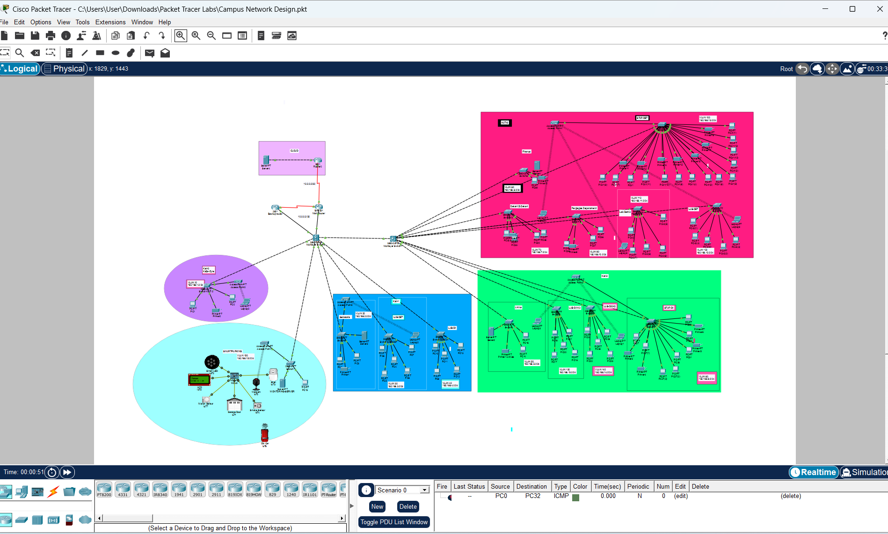

# Campus Network Design – Cisco Packet Tracer

## 1. Project Overview

This project presents the design and simulation of a multi-floor campus network for a Faculty of Information Technology using Cisco Packet Tracer.

The network was designed to provide reliable connectivity between departments while ensuring network segmentation, centralized services, security, redundancy, and external connectivity.

The implementation includes a hierarchical network architecture across four floors, with 15 VLANs, Inter-VLAN Routing, DHCP, HSRP, ACLs, static routing, WAN/Cloud connectivity, and an IoT-based Smart Parking system.

## 2. Project Objectives

- Design a scalable hierarchical network architecture across four floors.
- Configure 15 VLANs for traffic segmentation across departments.
- Implement Inter-VLAN Routing between network segments.
- Deploy centralized DHCP services for automatic IP address allocation.
- Implement HSRP for gateway redundancy and failover.
- Apply ACL rules to control traffic and secure sensitive network segments.
- Configure static routing and WAN/Cloud connectivity.
- Integrate an IoT-based Smart Parking system.
- Perform connectivity, redundancy, security, and functionality testing.

## 3. Technologies and Protocols

- Cisco Packet Tracer
- VLANs and IEEE 802.1Q Trunking
- Inter-VLAN Routing
- DHCP
- HSRP (Gateway Redundancy)
- Access Control Lists (ACLs)
- Static Routing
- Spanning Tree Protocol (STP)
- WAN/Cloud Connectivity
- IoT Smart Parking

## 4. Network Architecture



The network consists of:

- Main Router and Backup Router.
- Two Core Switches.
- Access switches distributed across four floors.
- 15 VLANs for departmental and service segmentation.
- Dedicated VLANs for different departments and network services.
- WAN/Cloud connectivity.
- IoT devices for the Smart Parking system.

The hierarchical architecture separates network functions across core and access layers, providing a structured approach to traffic management and network expansion.

## 5. Implementation

### 5.1 VLAN Configuration and Network Segmentation

Configured 15 VLANs to separate departmental traffic and improve network organization, isolation, and security.

### 5.2 Inter-VLAN Routing

Implemented Inter-VLAN Routing to enable communication between different VLANs according to the network design.

### 5.3 DHCP Services

Configured centralized DHCP services to automatically allocate IP addresses to network devices.

### 5.4 Gateway Redundancy – HSRP

Implemented HSRP using a main router and backup router to provide gateway redundancy and maintain network availability during router failures.

### 5.5 Spanning Tree Protocol (STP)

Configured and verified Spanning Tree Protocol to prevent Layer 2 switching loops and maintain a stable switching topology.

### 5.6 Access Control Lists (ACLs)

Applied ACL rules to control traffic between network segments and restrict unauthorized access to sensitive departmental resources.

### 5.7 Static Routing and WAN Connectivity

Configured static routing and WAN/Cloud connectivity to enable communication between internal network segments and external networks.

### 5.8 IoT Smart Parking

Integrated an IoT-based Smart Parking system using simulated sensors and actuators.

The implementation includes motion detection, smoke detection, garage door control, smart LED indicators, a siren, and an LCD display.

## 6. Verification and Testing

The network was tested to verify connectivity, routing, redundancy, security, and IoT functionality.

The following Cisco IOS commands were used during configuration and verification:

```bash
show vlan brief
show interfaces trunk
show ip route
show ip dhcp pool
show ip dhcp binding
show standby brief
show spanning-tree
show access-lists
show running-config
```

Testing included:

- VLAN creation and segmentation verification.
- Trunk connectivity between switches.
- Inter-VLAN connectivity verification.
- DHCP address allocation.
- HSRP active/standby status and failover testing.
- Static routing and WAN connectivity verification.
- ACL traffic filtering.
- IoT Smart Parking functionality.

Screenshots, configuration files, and additional verification results are maintained in the repository.

## 7. Repository Contents

The repository contains:

- Cisco Packet Tracer simulation file (`.pkt`).
- Network topology diagram.
- Router and switch configuration files.
- IoT Smart Parking implementation files.
- Verification screenshots.
- Project documentation.

## 8. Future Improvements

The project can be further developed through:

- More detailed VLAN and IP addressing documentation.
- Additional verification of HSRP failover scenarios.
- Expanded ACL testing and security validation.
- Improved documentation of inter-switch trunking and STP behaviour.
- Additional IoT Smart Parking functionality.
- More detailed network testing and troubleshooting evidence.

## 9. Learning Outcomes

This project strengthened my practical understanding of enterprise campus network design, routing and switching, VLAN segmentation, centralized network services, gateway redundancy, access control, WAN connectivity, and IoT integration.

It also provided practical experience in designing, configuring, testing, and troubleshooting a multi-floor enterprise network environment.

---

**Project Area:** Network Engineering / Enterprise Networking / Routing & Switching

**Platform:** Cisco Packet Tracer

**Project Status:** Initial implementation completed – further documentation and improvements planned.
